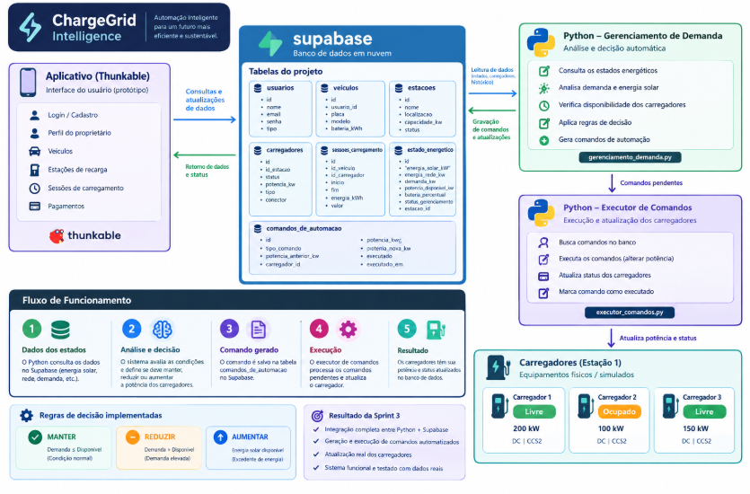
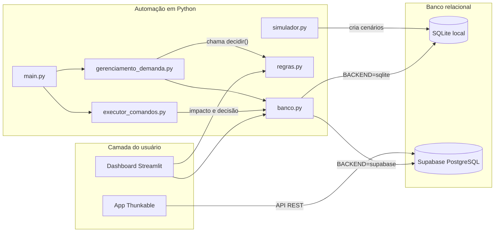
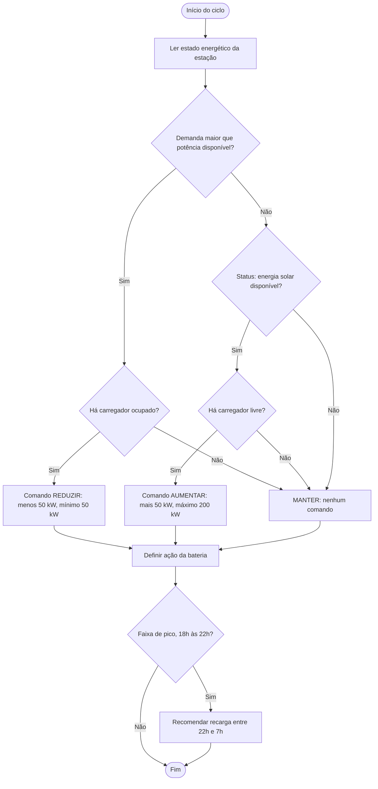
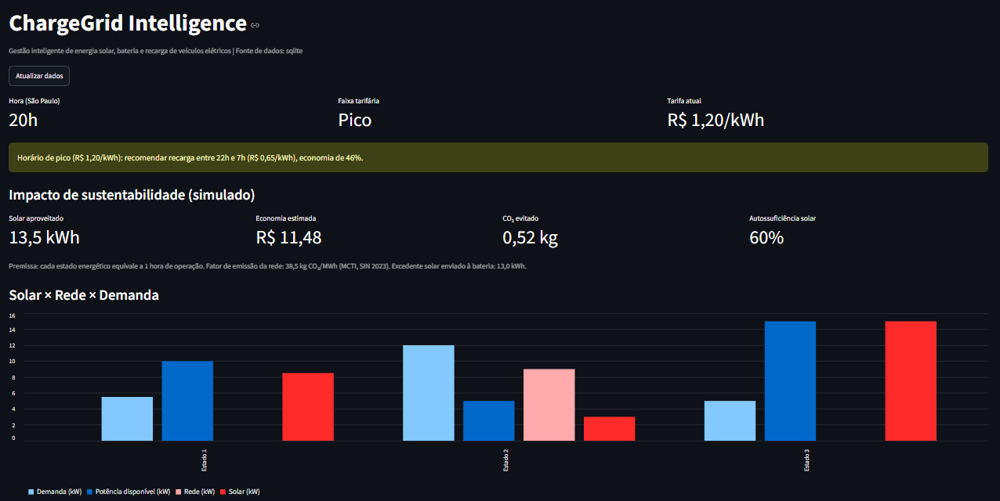
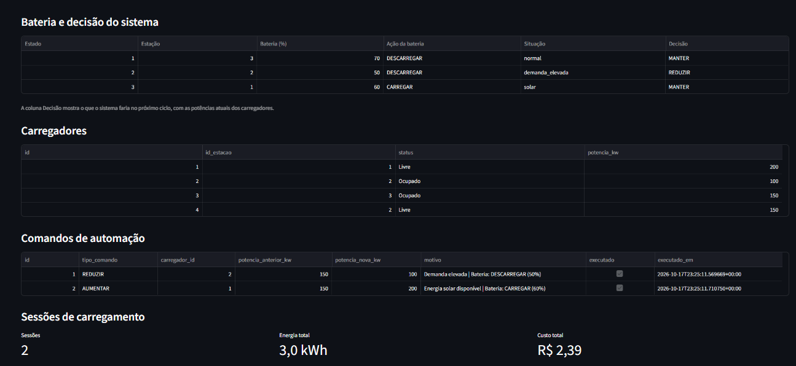
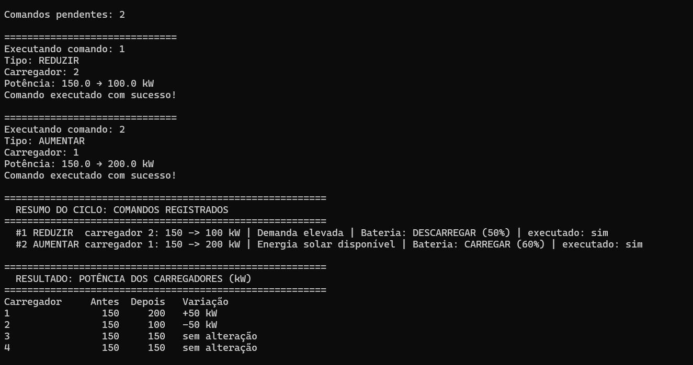

# ChargeGrid Intelligence

**Gestão inteligente de energia solar, armazenamento e recarga de veículos elétricos em ambiente comercial**

Sprint 4 — Solução Final Integrada e Inovadora | Desafio GoodWe | FIAP — Ciência da Computação, Turma 1CCPI (Equipe 04)

---

## Sumário

1. [Equipe](#1-equipe)
2. [O problema e a proposta](#2-o-problema-e-a-proposta)
3. [Arquitetura final e integração](#3-arquitetura-final-e-integração)
4. [Como o sistema decide (algoritmo)](#4-como-o-sistema-decide-algoritmo)
5. [Alinhamento ao desafio GoodWe](#5-alinhamento-ao-desafio-goodwe)
6. [Alinhamento à disciplina e Pensamento Computacional](#6-alinhamento-à-disciplina-e-pensamento-computacional)
7. [Resultados quantitativos e qualitativos](#7-resultados-quantitativos-e-qualitativos)
8. [Avaliação crítica: sustentabilidade, inovação e limitações](#8-avaliação-crítica-sustentabilidade-inovação-e-limitações)
9. [Tecnologias, frameworks e ferramentas](#9-tecnologias-frameworks-e-ferramentas)
10. [Como executar](#10-como-executar)
11. [Estrutura do repositório](#11-estrutura-do-repositório)
12. [Evolução do projeto (Sprints 1 a 4)](#12-evolução-do-projeto-sprints-1-a-4)
13. [Referências](#13-referências)

---

## 1. Equipe

| Integrante | RM |
|---|---|
| Guilherme Miranda | 573107 |
| Carlos Eduardo | 572949 |
| Rafael Gandolfi | 569036 |
| João Soler | 569725 |
| Rafael Lins | 570588 |
| Cauã Paes | 569906 |

---

## 2. O problema e a proposta

Em um estacionamento comercial, vários veículos elétricos recarregam ao mesmo tempo. Isso gera três problemas:

- **Picos de demanda:** a soma das recargas pode ultrapassar a potência que a instalação suporta.
- **Energia mal aproveitada:** a geração solar pode sobrar enquanto a rede é usada, ou ficar subutilizada.
- **Custo:** recarregar no horário de pico custa quase o dobro do horário de menor tarifa (R$ 1,20 contra R$ 0,65 por kWh nos valores usados no projeto).

O **ChargeGrid Intelligence** é uma plataforma que integra aplicativo, banco de dados em nuvem, telemetria de energia (solar, rede, bateria), tarifação e uma camada de automação. A automação lê o estado energético, decide se mantém, reduz ou amplia a potência dos carregadores, gerencia a bateria e recomenda recarga em horário de menor tarifa. Tudo fica registrado e visível em um dashboard.

> **Escopo desta entrega:** os dados de energia são **simulados** e armazenados em banco relacional (SQLite local ou Supabase). Não há integração física com equipamentos GoodWe. A seção 5 mostra como cada componente simulado corresponde a um equipamento ou serviço real da GoodWe.

---

## 3. Arquitetura final e integração



*Arquitetura base entregue na Sprint 3. É uma ilustração: os nomes exatos de tabelas e colunas estão em `database/estrutura-banco.sql`. A versão final, com a camada de dados, o simulador e o dashboard, é o diagrama abaixo.*

**Arquitetura final (Sprint 4):**



### Dois backends de dados

A camada `banco.py` expõe a mesma interface para dois bancos:

| Backend | Quando usar | Requisitos |
|---|---|---|
| **SQLite local** (padrão sem credenciais) | Reprodução por qualquer pessoa, testes e demonstração | Nenhum. O arquivo `chargegrid.db` é criado automaticamente |
| **Supabase (PostgreSQL)** | Integração com o aplicativo Thunkable e dados na nuvem | `SUPABASE_URL` e `SUPABASE_KEY` no `.env` |

O esquema local mantém os mesmos nomes de tabelas e colunas do Supabase e declara **chaves estrangeiras reais**. O esquema PostgreSQL equivalente está em `database/estrutura-banco.sql`, com restrições adicionais (por exemplo, bateria entre 0 e 100% e status válidos). O restante do sistema (regras, automação e dashboard) não sabe qual backend está em uso. Essa separação também resolve um problema prático: projetos gratuitos do Supabase são pausados após um período sem uso, e o plano local garante que a solução continue executável e verificável.

### Fluxo funcional completo

1. O usuário consulta uma estação no aplicativo e seleciona veículo e carregador.
2. Uma **sessão** é criada e o carregador passa para *ocupado*.
3. O sistema lê o **estado energético** (solar, rede, demanda, potência disponível, bateria).
4. `regras.decidir()` escolhe: **manter**, **reduzir** ou **aumentar** a potência, define a ação da **bateria** e, no pico, gera uma **recomendação de horário**.
5. O comando é gravado em `comandos_de_automacao` com `executado = false`.
6. `executor_comandos.py` aplica a nova potência ao carregador e marca o comando como executado, com data e hora.
7. Ao finalizar, energia (kWh) e custo (R$) são registrados e o carregador volta a *livre*.
8. O **dashboard** mostra estados, comandos, sessões e o impacto de sustentabilidade.

### Modelo de dados

A sessão integra usuário, veículo, estação, carregador e tarifa. O carregador pertence a uma estação por `carregadores.id_estacao`.

| Tabela | Papel |
|---|---|
| `sessoes_carregamento` | `usuario_id`, `veiculo_id`, `estacao_id`, `carregador_id`, `tarifa_id`, `energia_kWh`, `custo`, `tempo_inicial`, `tempo_final`, `status` |
| `carregadores` | `id`, `id_estacao`, `status` (livre/ocupado), `potencia_kw` |
| `estado_energetico` | `energia_solar_kW`, `energia_rede_kw`, `demanda_kw`, `potencia_disponivel_kw`, `bateria_percentual`, `status_gerenciamento` |
| `comandos_de_automacao` | `tipo_comando`, `carregador_id`, `potencia_anterior_kw`, `potencia_nova_kw`, `motivo`, `executado`, `executado_em` |

---

## 4. Como o sistema decide (algoritmo)

A decisão está isolada em `regras.py` (lógica pura, sem banco). Isso permite testar as regras e reaproveitá-las no dashboard.



### Regras

| Situação | Condição | Ação nos carregadores | Ação na bateria |
|---|---|---|---|
| Demanda elevada | demanda > potência disponível | **REDUZIR** 50 kW no primeiro carregador ocupado (mínimo 50 kW) | Descarregar, se SOC acima de 20% |
| Solar disponível | status "Energia solar disponível" | **AUMENTAR** 50 kW em carregador livre (máximo 200 kW) | Carregar, se SOC abaixo de 95% |
| Normal | demanda ≤ potência disponível | **MANTER** | Manter |
| Horário de pico | 18h às 22h (R$ 1,20/kWh) | Recomendação de recarga em 22h às 7h (economia de 46%) | Descarregar, se SOC acima de 20% e sem excedente solar |

**Prioridade da bateria:** demanda elevada, depois excedente solar, depois horário de pico. Com excedente solar a bateria carrega mesmo no pico.

**Por que aumentar um carregador livre?** É um *pré-ajuste de capacidade*: o excedente solar já está disponível, então a potência máxima do ponto é elevada antes de o próximo veículo conectar. Assim o veículo seguinte já recarrega mais rápido com energia renovável.

**Proteções:** o sistema não cria um segundo comando enquanto houver um pendente para o mesmo carregador, e respeita os limites de 50 kW e 200 kW.

---

## 5. Alinhamento ao desafio GoodWe

A GoodWe atua com inversores fotovoltaicos, armazenamento de energia e carregadores de veículos elétricos, e oferece plataformas de monitoramento. O projeto simula uma estação que usaria esse ecossistema. A tabela mostra o que é simulado e o que existe na GoodWe.

| Componente do projeto | Equivalente GoodWe | Situação |
|---|---|---|
| `energia_solar_kW` | Telemetria de geração de um inversor fotovoltaico ou híbrido GoodWe | Simulado |
| `bateria_percentual` | Estado de carga (SOC) da bateria ligada a um inversor híbrido (séries ET/EH/BH/BT/ESA) | Simulado |
| `energia_rede_kw` e `demanda_kw` | Medição de consumo e de rede (smart meter, como o GoodWe HomeKit) | Simulado |
| Carregadores e `potencia_kw` | Carregadores GoodWe da série HCA (AC, 7 kW monofásico e 11/22 kW trifásico), com carga por excedente solar e controle pelo portal e app | Simulado, com potências maiores |
| Dashboard e app Thunkable | Plataformas SEMS Portal e SEMS+ (monitoramento web e app) | Equivalente funcional próprio |
| `comandos_de_automacao` | Ajuste de potência de recarga (load management) | Proposto para produção |
| Regra de tarifa e pico | Programação de carga e descarga da bateria por horário, recurso dos inversores híbridos GoodWe | Implementado nas regras |

### Pontos em que a solução conversa com a GoodWe

- **Uso do excedente solar na recarga.** Os carregadores HCA da GoodWe têm modo de carga com excedente fotovoltaico. O projeto implementa a mesma ideia na regra *Solar disponível*.
- **Armazenamento.** A GoodWe é referência em inversores com bateria. A bateria entra na decisão: carrega com excedente solar e descarrega na demanda elevada e no pico.
- **Monitoramento centralizado.** O SEMS Portal reúne geração, consumo e armazenamento em um painel. O dashboard do projeto faz o equivalente: solar × rede × demanda, bateria, comandos e sessões.
- **Gestão digital com IA.** A GoodWe lançou o SEMS+, que inclui um agente de IA em linguagem natural e análise de padrões de consumo. A evolução natural do projeto é um assistente que explique cada decisão (seção 8).
- **Protocolos abertos.** Inversores híbridos GoodWe podem ser lidos e controlados por Modbus (RS485 e TCP/IP), e existe uma biblioteca Python da comunidade para isso. Isso indica o caminho para trocar os dados simulados por dados reais sem mudar `regras.py`.

### Como cada pilar do desafio é atendido

| Pilar (Sprint 1) | Como a solução responde |
|---|---|
| Controle de demanda | `REDUZIR` quando a demanda passa da potência disponível, com limites e sem comandos duplicados |
| Protocolos abertos | Banco relacional, API REST e regras desacopladas do hardware; ponto de troca previsto para Modbus |
| Tarifação e pagamento | Três faixas tarifárias, custo por sessão em R$ e recomendação de recarga fora do pico |
| Inteligência artificial | Base de decisão explicável por regras. A previsão de demanda é trabalho futuro |

---

## 6. Alinhamento à disciplina e Pensamento Computacional

| Conteúdo da disciplina | Onde aparece |
|---|---|
| Banco de dados relacional | Modelo com chaves primárias e estrangeiras (sessão integra usuário, veículo, estação, carregador e tarifa) |
| APIs e integração | App Thunkable e scripts Python consomem o Supabase via REST |
| Programação | Python modular (`regras.py`, gerenciamento, executor, dashboard) e testes automatizados |
| Automação | Ciclo analisar, comandar, executar e atualizar |
| Lógica de decisão | Árvore de regras com prioridades e limites |
| Tarifação | Faixas horárias e cálculo de custo |
| Sustentabilidade e eficiência energética | Uso de excedente solar, bateria, deslocamento de recarga e métricas de impacto |

### Pensamento Computacional

**Decomposição.** O problema foi dividido em módulos independentes:

| Módulo | Responsabilidade |
|---|---|
| `regras.py` | Decide (lógica pura) |
| `gerenciamento_demanda.py` | Lê o banco, chama a decisão e grava o comando |
| `executor_comandos.py` | Executa o comando e atualiza o carregador |
| `banco.py` | Acessa os dados (SQLite ou Supabase) com a mesma interface |
| `simulador.py` | Cria os cenários de teste e mostra o antes e depois |
| `main.py` | Orquestra o ciclo |
| `dashboard.py` | Visualiza |

**Reconhecimento de padrões.** O sistema identifica três situações recorrentes (demanda elevada, solar disponível e normal) e um padrão horário (pico, normal e fora de pico). Cada padrão tem uma resposta padronizada.

**Abstração.** O mundo real foi reduzido a poucas variáveis: solar, rede, demanda, potência disponível, bateria, status do carregador e hora. Detalhes como curvas de bateria, perdas e tensão foram deliberadamente ignorados.

**Algoritmo.** O fluxograma da seção 4 e o pseudocódigo abaixo formalizam a lógica:

```text
ALGORITMO decidir(estado, carregadores, hora)
  faixa <- faixa_tarifaria(hora)
  SE estado.demanda > estado.potencia_disponivel ENTÃO
      situacao <- DEMANDA_ELEVADA
  SENÃO SE estado.status = "Energia solar disponível" ENTÃO
      situacao <- SOLAR
  SENÃO
      situacao <- NORMAL
  FIM SE

  bateria <- acao_bateria(estado.bateria, situacao, faixa)
  comando <- NENHUM

  SE situacao = DEMANDA_ELEVADA ENTÃO
      alvo <- primeiro carregador com status "ocupado"
      SE alvo existe E alvo.potencia > 50 ENTÃO
          comando <- REDUZIR(alvo, max(alvo.potencia - 50, 50))
  SENÃO SE situacao = SOLAR ENTÃO
      alvo <- primeiro carregador com status "livre"
      SE alvo existe E alvo.potencia < 200 ENTÃO
          comando <- AUMENTAR(alvo, min(alvo.potencia + 50, 200))
  FIM SE

  SE faixa = "Pico" ENTÃO recomendar recarga entre 22h e 7h
  RETORNAR comando, bateria, recomendação
FIM ALGORITMO
```

---

## 7. Resultados quantitativos e qualitativos

### 7.1 Cenários de teste (simulados)

| Cenário | Solar | Demanda | Potência disponível | Decisão do sistema | Resultado no banco |
|---|---|---|---|---|---|
| Normal | 8,5 kW | 5,5 kW | 10 kW | MANTER | Nenhum comando criado |
| Demanda elevada | 3,0 kW | 12 kW | 5 kW | REDUZIR | Carregador 2: 150 kW → 100 kW (−33%) |
| Solar disponível | 15 kW | 5 kW | 15 kW | AUMENTAR | Carregador 1: 150 kW → 200 kW (+33%) |

Os comandos foram gravados em `comandos_de_automacao`, executados por `executor_comandos.py` e confirmados com a atualização da potência na tabela `carregadores`.

Reprodução automatizada com `python simulador.py --demo` (banco local, saída real da execução):

| Carregador | Antes | Depois | Variação |
|---|---|---|---|
| 1 (Paulista, livre, solar disponível) | 150 kW | 200 kW | +50 kW |
| 2 (Pinheiros, ocupado, demanda elevada) | 150 kW | 100 kW | −50 kW |
| 3 (Vila Olímpia, ocupado, normal) | 150 kW | 150 kW | sem alteração |
| 4 (Pinheiros, livre) | 150 kW | 150 kW | sem alteração |

O carregador 4 mostra que o sistema escolhe o carregador **ocupado** na demanda elevada, e não qualquer um da estação.

### 7.2 Impacto de sustentabilidade (calculado por `regras.calcular_impacto`)

Premissas: cada estado energético equivale a 1 hora de operação; tarifa de referência Normal (R$ 0,85/kWh); fator de emissão da rede de 38,5 kg CO₂/MWh (MCTI, média do SIN em 2023).

| Indicador | Valor nos 3 cenários |
|---|---|
| Energia solar gerada | 26,5 kWh |
| Energia solar efetivamente usada | 13,5 kWh |
| Excedente solar direcionado à bateria | 13,0 kWh |
| Autossuficiência solar (solar usado ÷ demanda) | 60% |
| Economia estimada | R$ 11,48 |
| CO₂ evitado | 0,52 kg |

> Os valores acima foram calculados com a função do projeto sobre os três cenários da tabela 7.1. O dashboard recalcula esses indicadores com os dados reais da sua base a cada atualização.

### 7.3 Deslocamento de recarga para fora do pico

Para uma recarga de 10 kWh:

| Horário | Tarifa | Custo |
|---|---|---|
| Pico (18h às 22h) | R$ 1,20/kWh | R$ 12,00 |
| Fora de pico (22h às 7h) | R$ 0,65/kWh | R$ 6,50 |
| **Economia ao deslocar** | | **R$ 5,50 (46%)** |

### 7.4 Qualidade do software

- 8 testes das regras em `test_regras.py`: faixas tarifárias, os três cenários, limites mínimo e máximo, bateria no pico, prioridade do excedente solar sobre o pico e cálculo de impacto. Execute `python test_regras.py`.
- 2 testes de integração em `test_ciclo.py`, com banco temporário: o ciclo completo atualiza os carregadores, uma segunda análise não duplica comandos pendentes e as chaves estrangeiras são aplicadas. Execute `python test_ciclo.py`.
- Proteção contra comandos duplicados para o mesmo carregador.
- Credenciais fora do código (`.env`, ignorado pelo Git).

### 7.5 Resultados qualitativos

- A decisão é **explicável**: cada comando guarda o `motivo`, incluindo a ação da bateria.
- O ciclo completo (dados, decisão, comando, execução e atualização) roda com um único comando: `python main.py`.
- O aplicativo mostra a tarifa vigente, as estações, o histórico de recargas, os pagamentos e o perfil do usuário.

### 7.6 Evidências visuais

| Evidência | Arquivo |
|---|---|
| Dashboard, parte superior: tarifa, impacto de sustentabilidade e gráfico solar × rede × demanda | `docs/img/dashboard-topo.png` |
| Dashboard, parte inferior: bateria e decisão, carregadores, comandos executados e sessões | `docs/img/dashboard-base.png` |
| Execução do ciclo no terminal, com o resumo dos comandos e o antes e depois | `docs/img/terminal-ciclo.png` |





---

## 8. Avaliação crítica: sustentabilidade, inovação e limitações

### Benefícios

- **Aproveitamento de energia renovável:** a regra solar e a bateria aumentam o uso local do excedente fotovoltaico.
- **Redução de custo:** o deslocamento para fora do pico reduz a tarifa em 46% no cenário usado.
- **Proteção da infraestrutura:** reduzir potência na demanda elevada evita sobrecarga.
- **Transparência:** tarifa, custo e decisões são visíveis ao usuário e ao operador.

### Diferenciais de inovação

- Algoritmo de decisão com **três variáveis combinadas** (demanda, solar e bateria) e **componente horário**.
- **Automação em ciclo fechado:** decide, registra, executa e confirma.
- **Dashboard** com métricas de impacto calculadas a partir dos dados.
- Arquitetura **desacoplada do hardware**: `regras.py` independe da origem dos dados.

### Limitações (declaradas com transparência)

1. **Dados simulados.** Não há leitura de equipamentos reais. A integração com GoodWe é proposta, não implementada.
2. **Potências dos carregadores.** Os carregadores HCA da GoodWe são de corrente alternada (7 a 22 kW). As potências de 50 a 200 kW usadas no projeto representam carregadores comerciais de alta potência, que não são o foco da série HCA. A lógica de decisão vale para ambos, mas os valores dos limites deveriam ser parametrizados por modelo.
3. **Bateria.** A ação da bateria é decidida e registrada, mas não há atuador simulado que altere o `bateria_percentual`.
4. **Impacto de CO₂ pequeno.** A rede elétrica brasileira já é predominantemente renovável, então o CO₂ evitado por kWh solar é baixo em números absolutos. O ganho mais expressivo está no custo e na autossuficiência.
5. **Premissa de 1 hora por estado** simplifica o cálculo de energia.
6. **Inteligência por regras.** Não há previsão de demanda com aprendizado de máquina.
7. **Disponibilidade do Supabase.** Projetos gratuitos são pausados por inatividade. Por isso o sistema tem o backend SQLite local, e a integração com o app Thunkable depende de o projeto Supabase estar ativo.
8. **Segurança.** O diagrama da Sprint 3 prevê um campo de senha na tabela de usuários. Em produção, a autenticação deve usar o Supabase Auth, que guarda senhas com hash, em vez de uma coluna na tabela. Para uso real, é preciso habilitar Row Level Security no Supabase e não usar chave com permissão total no cliente.

### Trabalhos futuros

- Ler dados reais de inversores GoodWe via Modbus e enviar comandos de potência.
- Previsão de demanda e de geração solar com modelos de séries temporais.
- Assistente virtual em linguagem natural que explique as decisões, no espírito do agente de IA do SEMS+.
- Compatibilidade com o protocolo OCPP para carregadores de outros fabricantes.
- Parametrização de limites de potência por modelo de carregador.

---

## 9. Tecnologias, frameworks e ferramentas

| Ferramenta | Uso | Motivo da escolha |
|---|---|---|
| **Python 3** | Regras, automação e dashboard | Linguagem da disciplina, com bibliotecas simples para dados e banco |
| **Supabase (PostgreSQL + API REST)** | Banco de dados na nuvem | Modelo relacional adequado às relações do sistema e API pronta |
| **SQLite (módulo `sqlite3`)** | Banco local do plano B e dos testes | Já vem com o Python, sem instalação nem credenciais |
| **supabase-py** | Cliente Python do Supabase (opcional) | Consultas e atualizações com poucas linhas |
| **Streamlit** | Dashboard | Visualização de dados em um único arquivo Python |
| **pandas** | Tabelas do dashboard | Manipulação de dados tabulares |
| **python-dotenv** | Credenciais | Mantém chaves fora do código |
| **Thunkable** | Protótipo do aplicativo móvel | Prototipação rápida da experiência do usuário |
| **Mermaid** | Diagramas neste README | Renderizado nativamente pelo GitHub |
| **Trello** | Gestão das Sprints (Kanban) | Organização das tarefas da equipe |

**Dados de entrada:** valores simulados de geração solar, rede, demanda, potência disponível e bateria, no formato que um inversor híbrido e um medidor inteligente forneceriam.

---

## 10. Como executar

**Pré-requisito:** Python 3.10 ou superior.

### Opção A: banco local (sem credenciais, recomendada para avaliação)

```bash
# 1. Baixe o repositório (botão Code > Download ZIP, ou git clone)
#    e abra um terminal dentro da pasta do projeto

# 2. Instalar dependências
pip install -r requirements.txt

# 3. Testes automatizados (regras e ciclo completo)
python test_regras.py
python test_ciclo.py

# 4. Demonstração completa: cria os cenários, roda o ciclo e mostra antes e depois
python simulador.py --demo

# 5. Dashboard
streamlit run dashboard.py
```

Para repetir o ciclo do zero, rode `python simulador.py` (recria o banco local) e depois `python main.py`.

### Opção B: Supabase (nuvem)

```bash
cp .env.example .env
# edite o .env com SUPABASE_URL e SUPABASE_KEY e deixe BACKEND=supabase
python main.py
streamlit run dashboard.py
```

Para criar o banco em um projeto Supabase novo, abra o **SQL Editor** e execute, nesta ordem:

1. `database/estrutura-banco.sql` (tabelas, chaves estrangeiras e restrições);
2. `database/dados-teste.sql` (os três cenários de teste).

Os dois arquivos foram validados em PostgreSQL 16 e geram as mesmas tabelas e colunas do banco local.

> Cada execução de `main.py` aplica um novo passo de 50 kW. Para reproduzir os cenários da tabela 7.1, restaure as potências antes (Opção A: `python simulador.py`).
> A faixa tarifária usa a hora de São Paulo. O aviso de horário de pico só aparece entre 18h e 22h.

---

## 11. Estrutura do repositório

```text
.
├── README.md                    # Este documento
├── main.py                      # Orquestra o ciclo de automação
├── regras.py                    # Algoritmo de decisão, tarifas, bateria e impacto
├── banco.py                     # Acesso a dados: SQLite local ou Supabase
├── simulador.py                 # Cenários de teste e demonstração antes/depois
├── gerenciamento_demanda.py     # Lê estados, decide e grava comandos
├── executor_comandos.py         # Executa comandos e atualiza carregadores
├── dashboard.py                 # Dashboard Streamlit
├── test_regras.py               # Testes das regras
├── test_ciclo.py                # Teste de integração do ciclo completo
├── database/
│   ├── estrutura-banco.sql      # Esquema PostgreSQL/Supabase (tabelas, FKs e restrições)
│   └── dados-teste.sql          # Dados simulados dos três cenários
├── requirements.txt             # Dependências
├── .env.example                 # Modelo de variáveis de ambiente
├── .gitignore                   # Ignora .env, banco local e caches
└── docs/
    └── img/                     # Diagrama de arquitetura e prints do dashboard e do terminal
```

---

## 12. Evolução do projeto (Sprints 1 a 4)

| Sprint | Entrega principal |
|---|---|
| 1 | Análise do ChargeGrid, dos quatro pilares e do cenário residencial × comercial |
| 2 | Primeiro simulador e prova de conceito |
| 3 | Arquitetura integrada: app Thunkable, Supabase e automação com comandos executados |
| 4 | Gestão de bateria, regra tarifária de pico, métricas de impacto, dashboard, camada de dados com dois backends, simulador, testes e documentação final |

---

## 13. Referências

- GoodWe, série de carregadores HCA (7, 11 e 22 kW, carga por excedente solar, monitoramento via SEMS): <https://shop.krannich-solar.com/de-en/e-mobility/charging-stations/42621/ev-charger-gw-22k-hca>
- GoodWe, HCA G2 (phase switching, load management, RS485, LAN e Wi-Fi): <https://shop.krannich-solar.com/en-de/GW-7K-HCA-G2/0162080>
- GoodWe, lançamento do SEMS+ no Brasil: <https://cenarioenergia.com.br/2026/02/26/goodwe-lanca-sems-e-acelera-gestao-digital-de-energia-com-plataforma-inteligente-no-brasil/>
- GoodWe, SEMS+ e agente de IA: <https://www.infobuildenergia.it/info_dalle_aziende/sems-di-goodwe-la-gestione-energetica-intelligente-di-nuova-generazione/>
- SEMS Portal e HomeKit (monitoramento de geração e consumo): <https://lightforce.co.nz/products/analytics-monitoring/>
- Controle de inversores híbridos GoodWe via Modbus (documentação evcc): <https://docs.evcc.io/en/meters/goodwe-et-eh-bh-bt-esa-hybrid-inverter>
- MCTI, fator de emissão do SIN em 2023 (38,5 kg CO₂/MWh): <https://eixos.com.br/brasil-tem-menor-taxa-de-emissao-de-carbono-na-geracao-eletrica-em-onze-anos/>
- Documentação do Supabase: <https://supabase.com/docs>
- Documentação do Streamlit: <https://docs.streamlit.io>
